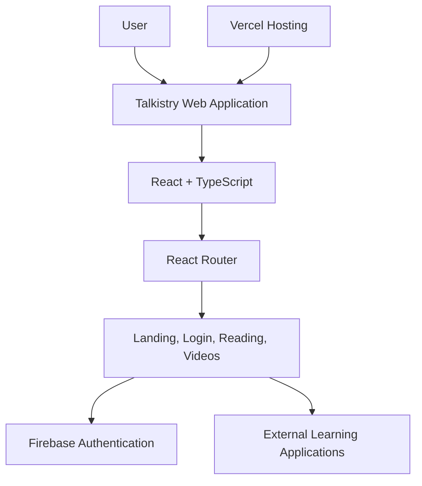

# Welcome to your Takistry project

# Talkistry – Communication Skills Learning Platform

**A modern web platform designed to help users improve their English communication skills through learning resources and interactive practice experiences.**

🌐 **Live Demo:** https://talkistry-33dj.vercel.app/

💻 **GitHub Repository:** https://github.com/rutikjagtap/Talkistry

---

## 📌 About the Project

Talkistry is a web-based communication skills learning platform designed for students, job seekers, working professionals, and individuals who want to improve their English communication skills.

The platform brings together different learning activities, including video-based learning, reading practice, conversational practice, mock interview resources, vocabulary exercises, and professional writing resources.

The application provides a centralized interface through which users can discover these learning opportunities and access the resources relevant to their needs.

Talkistry is developed using React, TypeScript, Tailwind CSS, and other modern frontend technologies. Firebase Authentication is used to support email-and-password registration and login.

## 🎯 Problem Statement

Communication skills are important for academic success, job interviews, workplace collaboration, and professional development.

However, learners may need to use multiple websites and applications to practise speaking, reading, vocabulary, and professional writing.

Talkistry aims to simplify access to these learning resources by providing a single web interface focused on communication skills development.

## 🚀 Project Objectives

- Provide a user-friendly platform for communication skills learning.
- Help learners discover resources for improving English communication.
- Organize learning opportunities into clear categories.
- Implement user registration and login using Firebase Authentication.
- Build a responsive interface using modern frontend technologies.
- Provide a foundation for integrating additional interactive learning features.

## ✨ Key Features

### 1. Video-Based Learning

Provides a dedicated page for learning through video content, supporting exposure to English listening materials and communication-related topics.

### 2. Reading and Story-Based Learning

Includes a stories page with reading material intended to support reading practice and vocabulary development.

### 3. Conversation Practice Resources

Provides access to an external conversational practice application through the platform's feature cards.

### 4. Mock Interview Resources

Provides access to an external interview-practice experience designed to help users prepare for interview questions.

### 5. Vocabulary Learning Resources

Links users to an external application for vocabulary practice and interactive exercises.

### 6. Professional Writing Resources

Provides access to an external writing application for exploring professional writing activities.

### 7. User Authentication

Uses Firebase Authentication to implement email-and-password account registration and login.

### 8. Interactive User Interface

Uses React components, responsive styling, icons, and animations to create a modern browsing experience.

**Implementation note:** Some learning activities are accessed through external applications. The main Talkistry repository should not be described as independently implementing those tools unless their underlying functionality is integrated into this codebase.

## 🛠️ Technology Stack

| Technology | Purpose |
|---|---|
| React | Component-based user interface |
| TypeScript | Static typing and maintainable application code |
| Vite | Development server and production build |
| Tailwind CSS | Styling and responsive layouts |
| shadcn/ui | Reusable interface components |
| React Router | Client-side navigation |
| Firebase Authentication | User registration and login |
| Framer Motion | Interface animations |
| Lucide React | Icons |
| Git and GitHub | Version control and repository management |
| Vercel | Application deployment |

## 🏗️ System Architecture

Talkistry follows a frontend-oriented architecture with Firebase Authentication and external learning-resource integrations.



The diagram represents the main application structure and integrations. It does not imply the existence of a custom backend or database.

## 🔐 Authentication Workflow

1. The user opens the registration or login page.
2. The registration form collects the user's name, email address, and password.
3. The application performs client-side input validation.
4. Firebase Authentication handles account creation or email-and-password sign-in.
5. The application displays a success or error message based on the authentication result.

The current registration and login implementations use Firebase Authentication. Password-reset functionality should be completed separately before it is documented as operational.

## ⚙️ Installation and Setup

### Prerequisites

Install the following:

- Node.js
- npm
- Git

### 1. Clone the repository

```bash
git clone https://github.com/rutikjagtap/Talkistry.git
```

### 2. Open the project directory

```bash
cd Talkistry
```

### 3. Install dependencies

```bash
npm install
```

### 4. Configure Firebase

Create or select a Firebase project and configure Firebase Authentication with the sign-in methods required by the application.

Verify that the application's Firebase configuration matches your Firebase project.

For a production application, keep private credentials out of the frontend and configure appropriate authentication and security settings.

### 5. Start the development server

```bash
npm run dev
```

### 6. Open the local application

Vite will display the local development URL in your terminal. The default is commonly:

```text
http://localhost:5173
```

### 7. Create a production build

```bash
npm run build
```

To preview the production build locally:

```bash
npm run preview
```

## 🌐 Deployment

Talkistry is deployed using Vercel.

The source repository is hosted on GitHub, and the live application is available at:

https://talkistry-33dj.vercel.app/

## 🔮 Future Enhancements

Potential improvements include:

- Integrating a functional AI-powered communication assistant.
- Implementing AI-based conversation practice within Talkistry.
- Adding functional AI interview simulations.
- Implementing grammar correction and vocabulary exercises.
- Integrating Firebase password-reset functionality.
- Introducing personalized learning paths.
- Adding user progress tracking and learning history.
- Developing a user dashboard with learning statistics.
- Improving accessibility and mobile usability.
- Adding automated tests for critical application flows.

These items represent proposed enhancements, not necessarily existing features.

## 📚 Learning Outcomes

This project provides practical experience in:

- Building reusable components with React.
- Developing frontend applications with TypeScript.
- Designing interfaces using Tailwind CSS.
- Managing application routes using React Router.
- Implementing authentication with Firebase.
- Building animated user interfaces.
- Using Git and GitHub for source-code management.
- Deploying a web application with Vercel.
- Structuring and documenting a software project.

## 👨‍💻 Author

**Rutik Jagtap**

GitHub: https://github.com/rutikjagtap

Project: Talkistry – Communication Skills Learning Platform

## 📄 License

No license has been specified in this README. Add an appropriate license file if you intend to distribute the project under an open-source license.
# Talkistry
# Talkistry
